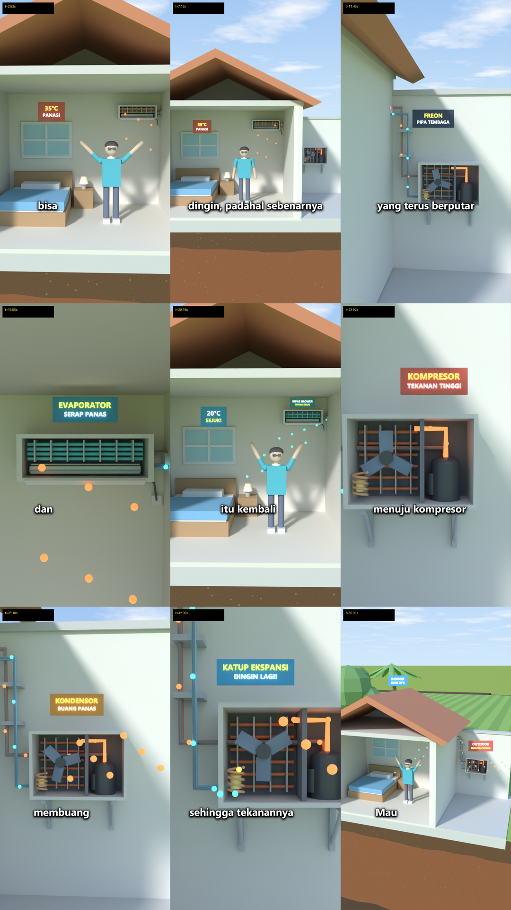
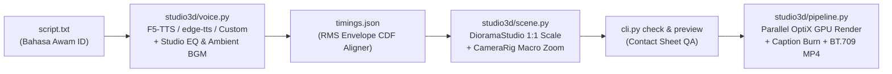

# id-3d-blender-video-skill

[](CHANGELOG.md)
[](LICENSE)
[](https://pypi.org/project/bpy/)
[](#hardware--software-requirements)

**100% Free, Local, Standalone AI Agent Skill & Clean-Room Python Engine (`studio3d`)** untuk membuat video edukasi teknik 3D *cutaway* vertikal (`1080×1920`, 30 fps) berbahasa Indonesia — dirender lokal di GPU **NVIDIA RTX (OptiX)** tanpa akun berbayar Higgsfield, ElevenLabs, maupun sewa GPU cloud.

Kompatibel dengan **Antigravity**, **Claude Code**, **Cursor**, dan **Gemini CLI** melalui spesifikasi standar [`SKILL.md`](SKILL.md).

---

## Visual Preview (`examples/ac_split_1pk`)

Hasil render langsung dari engine standalone `studio3d` di **NVIDIA GeForce RTX 4050 Laptop (OptiX Hardware Denoiser)** — skala nyata 1 PK (`1 unit = 1 meter`), istilah awam Indonesia (*"freon"*), karakter edukator orisinal, dan *macro zoom* komponen dalam:



---

## Fitur Utama

- **100% Standalone & Clean-Room (MIT License):** Dibangun dari nol dengan arsitektur OOP Python modular (`studio3d/`), bebas *deprecation warning* Blender 5.3/6.0, lintas OS (Windows, macOS, Linux).
- **100% Gratis & Lokal (Rp 0):** Render raytracing **Cycles OptiX + OptiX AI Denoiser** langsung di GPU lokal; suara AI Bahasa Indonesia melodi & ekspresif via **F5-TTS-INDO-FINETUNE-V2** lokal (+ opsi `edge-tts` dan rekaman suara sendiri).
- **Audio-First Word-Synced Timeline:** Seluruh gerakan kamera, animasi komponen, aliran partikel, label 3D, dan caption 2–4 kata dikunci otomatis ke *timestamp* per kata (`timings.json`) hasil *RMS speech-envelope CDF alignment*.
- **Skala Realistis 1:1 + Macro Cutaway:** Objek dimodelkan sesuai ukuran dunia nyata (`1.0 unit = 1 meter`) relatif terhadap figur edukator `1,72 m`, dipadukan dengan transisi kamera *macro zoom* halus untuk melihat jeroan mesin.
- **Pipeline QA & Warna Akurat BT.709:** Dilengkapi audit scene tanpa render (`cli.py check`), *preview contact sheet* ber-caption (`cli.py preview`), audit kecerahan & kelengkapan setiap frame, serta konversi warna eksplisit **BT.709** melalui `image2pipe` PNG → FFmpeg H.264.

---

## Alur Konsep, Arsitektur & Algoritma



Penjelasan matematis dan teknis lengkap (algoritma *RMS speech-envelope CDF word alignment*, *biquad EQ + 2.6:1 dynamic mastering DSP*, sintesis referensi multi-pitch tanpa impersonasi, *strided multi-worker GPU rendering*, dan *BT.709 color matrix*) tersedia di **[`docs/ARCHITECTURE.md`](docs/ARCHITECTURE.md)**.

---

## Spesifikasi Minimal & Rekomendasi

| Komponen | Minimal (CPU / Ringan) | Rekomendasi (Lokal Cepat 1080p) | Optimal (Produksi) |
| :--- | :--- | :--- | :--- |
| **GPU** | CPU-only (`edge-tts`) | **NVIDIA RTX 3050 / RTX 4050 (6 GB VRAM)** | **NVIDIA RTX 3060 12 GB / RTX 4070+ (12–16 GB)** |
| **RAM** | 8 GB | **16 GB** | **32 GB** |
| **Penyimpanan** | ~3 GB (`bpy` + `edge-tts`) | **~12–15 GB** *(~9 GB setelah `pip cache purge`)* | **25 GB+ SSD/NVMe** |
| **Software** | Python 3.11–3.13, `bpy 5.3+`, FFmpeg | + Python 3.11 `.venv-tts` (PyTorch CUDA 12.4 + `f5-tts`) | Driver NVIDIA ≥ 535 + OptiX |
| **Estimasi Render (42 dtk)** | CPU (~2–4 jam) | **~20–28 menit** *(teruji di RTX 4050: ~0,7–1,1 fps)* | **~8–14 menit** |

Detail benchmark lengkap & panduan hemat penyimpanan tersedia di **[`docs/HARDWARE_SPECS.md`](docs/HARDWARE_SPECS.md)**.

---

## Quick Start

### 1. Clone & Instalasi Dependensi
```bash
git clone https://github.com/MohRobyTrio/id-3d-blender-video-skill.git
cd id-3d-blender-video-skill

# Pasang Blender bpy + dependensi inti (cukup untuk render + backend edge-tts/custom)
python setup.py

# Opsional: pasang lingkungan CUDA Python 3.11 terisolasi + bobot F5-TTS-INDO-FINETUNE-V2 (~4 GB total)
python setup.py --with-f5-tts --py311 /path/to/python3.11
```

### 2. Jalankan Contoh Bawaan (`examples/ac_split_1pk`)
```bash
# 1. Generate suara + timings.json (pilih --backend f5_indo | edge | custom)
.venv-tts/Scripts/python cli.py voice examples/ac_split_1pk --backend f5_indo

# 2. Verifikasi potongan frasa caption & audit 3D tanpa render
python cli.py phrases examples/ac_split_1pk
python cli.py check examples/ac_split_1pk

# 3. Render preview contact sheet 3x3 (540x960 @ 12 spp, ~15 detik di RTX 4050)
python cli.py preview examples/ac_split_1pk

# 4. Render penuh 1080x1920 30fps + bakar caption + encode MP4 BT.709
python cli.py render examples/ac_split_1pk --samples 12 --workers 2
```

---

## Cara Memasang Sebagai AI Agent Skill

Cukup salin folder repo (atau `SKILL.md`) ke direktori skill agen pilihan Anda:

| AI Coding Agent | Lokasi Skill Global |
| :--- | :--- |
| **Google Antigravity** | `~/.gemini/config/skills/id-3d-blender-video-skill/SKILL.md` |
| **Claude Code** | `~/.claude/skills/id-3d-blender-video-skill/SKILL.md` |
| **Cursor** | `.cursor/rules/` atau workspace `.agents/skills/` |
| **Gemini CLI** | `~/.gemini/skills/id-3d-blender-video-skill/SKILL.md` |

Setelah terpasang, cukup minta agen: *"Buat video edukasi 3D tentang cara kerja kulkas pakai skill `blender-3d-explainer-id`"*.

---

## Struktur Repositori

```text
id-3d-blender-video-skill/
├── SKILL.md                  # Instruksi & standar kualitas untuk AI Agent
├── cli.py                    # CLI lintas OS (voice, phrases, check, preview, render, encode)
├── setup.py                  # Installer otomatis bpy, PyTorch CUDA, & F5-TTS
├── studio3d/                 # Engine clean-room Python (MIT)
│   ├── __init__.py           # Metadata versi (v1.0.0)
│   ├── timeline.py           # Parser naskah, cue kata, pengelompokan frasa 2-4 kata
│   ├── scene.py              # DioramaStudio Blender 5.3+, CameraRig, shader, educator figure
│   ├── voice.py              # Engine TTS lokal, biquad mastering, ambient BGM, CDF aligner
│   └── pipeline.py           # Contact sheet, render paralel GPU, caption & encoder BT.709
├── examples/
│   └── ac_split_1pk/         # Contoh lengkap skala nyata AC 1 PK ("freon")
├── docs/
│   ├── ARCHITECTURE.md       # Deep-dive arsitektur, rumus DSP & algoritma
│   ├── HARDWARE_SPECS.md     # Spek minimal/rekomendasi & benchmark RTX 4050
│   └── assets/               # Preview contact sheet hasil render nyata
├── CHANGELOG.md              # Riwayat versi rilis (SemVer)
└── LICENSE                   # MIT License
```

---

## Lisensi, Etika AI & Catatan Komersial

- **Kode Repositori Ini:** Berlisensi **[MIT License](LICENSE)** — bebas digunakan, dimodifikasi, dan dibagikan (100% implementasi *clean-room* orisinal).
- **Catatan Lisensi Model Suara Eksternal (Diunduh Terpisah oleh Pengguna):**
  - Model komunitas **`Eempostor/F5-TTS-INDO-FINETUNE-V2`** di Hugging Face berlisensi **CC BY-NC 4.0** (non-komersial dan **dilarang digunakan untuk impersonasi suara orang lain**).
  - Untuk kebutuhan **komersial**, gunakan `--backend custom` (rekaman suara Anda sendiri, otomatis di-mastering & disinkronkan oleh `studio3d`), `--backend edge`, atau model TTS berlisensi permisif seperti **Chatterbox (MIT)**.
- **Inspirasi:** Terinspirasi oleh ekosistem kreator video edukasi teknik 3D *cutaway* vertikal dan komunitas pemrograman prosedural Blender Python (`bpy`).
