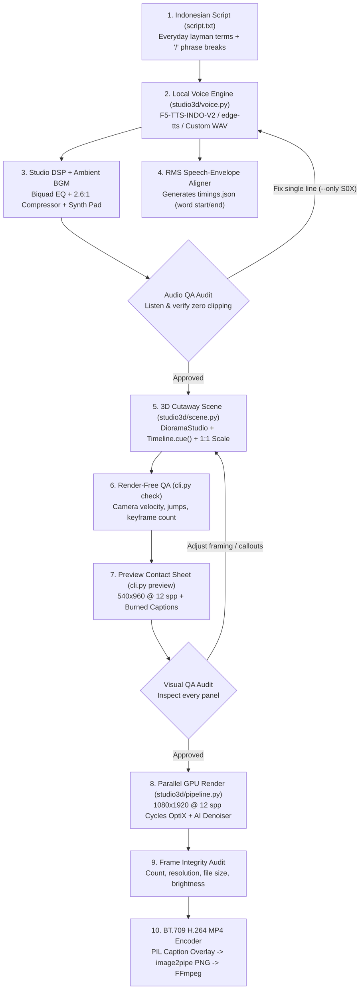

# Architecture, Concepts & Algorithms

This document explains the clean-room architecture, mathematical models, and signal-processing algorithms behind **`id-3d-blender-video-skill` (`studio3d`)**.

---

## 1. End-to-End Pipeline Architecture

The system enforces an **Audio-First Procedural 3D Pipeline**. Narration audio is generated and verified *before* any 3D keyframe or camera movement is computed, guaranteeing that every animation cue, label pop-in, and caption phrase remains strictly locked to spoken syllables.

---

## 2. Core Algorithms

### 2.1 Audio-First Word-Cue Synchronization (`studio3d/timeline.py`)
- Every sentence in `script.txt` carries an immutable ID (`S01`, `S02`, ...) and explicit `/` phrase dividers every **2–4 words** to prevent horizontal caption overflow at `1080px` width.
- Digits are rejected at parse time so spoken token count matches `timings.json` 1-to-1.
- Scenes never hardcode raw seconds (`t = 14.3`). Instead, all animations query `Timeline.cue("S04", "evaporator")`, making the entire 3D choreography automatically re-time whenever narration speed or wording changes.

### 2.2 Speech-Envelope Cumulative Distribution Word Alignment (`studio3d/voice.py`)
Because local neural flow-matching TTS models (like F5-TTS) output raw waveforms without word-boundary metadata, `align_words_to_waveform()` computes millisecond-accurate token boundaries directly from each sentence's audio envelope without requiring an external ASR model:

1. **Short-time RMS Energy:** Partition sentence waveform into $10\,\text{ms}$ hops and compute root-mean-square energy $e_k$.
2. **Non-linear Speech Activity Compression:** Suppress silence floor while compressing loud peaks so quiet consonants still receive fair duration mass:
   $$a_k = \begin{cases} e_k^{0.45} + 0.06 & \text{if } e_k > 0.015 \\ 0.015 & \text{otherwise} \end{cases}$$
3. **Normalized Cumulative Distribution Function (CDF):** $F(k) = \frac{\sum_{j=0}^{k} a_j}{\sum_{j=0}^{N-1} a_j}$.
4. **Indonesian Syllable Weighting:** Each token receives duration weight $w_i = \max(1.3,\; 1.35 \cdot V_i + 0.18 \cdot L_i)$ where $V_i$ is its vowel count (`a, i, u, e, o`) and $L_i$ is letter length, plus punctuation pause weights ($+0.75$ for `,`, $+1.6$ for `.?!`).
5. **Inverse CDF Lookup:** Cumulative token fractions map via binary search (`np.searchsorted`) onto $F(k)$, naturally absorbing breath pauses at commas and periods.

### 2.3 Multi-Pitch Melodic Reference Synthesis & Studio Mastering (`studio3d/voice.py`)
- **Zero-Impersonation Expressive Reference:** F5-TTS conditions its output prosody directly on the fundamental frequency ($F_0$) variance of the reference clip. Rather than cloning any real person, `ensure_melodic_reference()` synthesizes a 3-contour Indonesian phrase combining an upbeat rising question (`+9 Hz`, `+10%`), a low suspenseful drop (`-4 Hz`, `+2%`), and an emphatic reveal (`+6 Hz`, `+12%`), padded with a `160 ms` silence tail to eliminate word-bleeding artifacts.
- **Pure-NumPy Biquad Studio Mastering Chain (`master_melodic_ai`):**
  1. **Breath Gate & Generous Tail Trim (`clean_breath_trim`)**: 15 ms RMS soft gate suppresses breath intakes while keeping a `160 ms` trailing tail so final Indonesian consonants (`-k`, `-t`, `-r`) never clip.
  2. **High-Pass Filter (`90 Hz`, $Q=0.707$)**: Eliminates sub-bass rumble.
  3. **Low-Shelf Warmth (`180 Hz`, $+2.0\,\text{dB}$)**: Adds clean chest resonance.
  4. **Mid-Low Boxy Scoop (`420 Hz`, $-1.8\,\text{dB}$, $Q=1.1$)**: Removes room mud for a modern polished AI timbre.
  5. **Vocal Presence (`3300 Hz`, $+3.0\,\text{dB}$, $Q=1.0$)** & **Air Shelf (`6000 Hz`, $+2.2\,\text{dB}$)**: Delivers crisp smartphone-speaker clarity.
  6. **Dynamic Leveling Compressor (`2.6:1`, 10 ms attack / 130 ms release) + $\tanh$ Soft Limiter**: Balances volume cleanly without squashing melodic emotional swells.
  7. **Procedural Ambient Bed**: Royalty-free 4-chord warm synth pad (`Cmaj9 → Am9 → Fmaj7 → G6`) mixed at `-26 dB` under narration.

### 2.4 1:1 Realistic Metric Cutaway & Macro Zoom Cinematography (`studio3d/scene.py`)
- **Strict Metric Proportions (`1.0 unit = 1 meter`):** Architectural rooms, furniture, human figures (`1.72 m`), and mechanical equipment are modeled at true real-world dimensions (e.g., a 1 PK indoor split AC measures `0.98 × 0.34 × 0.28 m` mounted flush high on the wall; outdoor condenser `0.88 × 0.62 × 0.36 m` bolted on steel L-brackets).
- **Macro Zoom Instead of Cartoon Oversizing:** To showcase compact internal components (evaporator coils, capillary helix, compressor) clearly on mobile vertical screens, `CameraRig` smoothly glides from wide room framing (`distance = 7.6–12.0 m`) down to tight macro cutaways (`distance = 1.85–2.85 m`), scaling 3D callout typography proportionally to viewport width $W(d) = d \cdot \frac{9}{16}$.
- **Continuous Spherical Orbit Choreography:** Every `add_shot()` eases smoothly with `SINE` `EASE_IN_OUT` from the previous shot's drift endpoint into the next pose, eliminating disorienting hard jumps.

### 2.5 Parallel GPU Cycles OptiX Rendering & BT.709 Color Accuracy (`studio3d/pipeline.py`)
- **Multi-Worker Strided Sharding:** `render_parallel_frames()` spawns $N$ isolated Blender Python processes rendering interleaved strides (`1, 3, 5...` and `2, 4, 6...`) with `use_persistent_data = True` and **OptiX Hardware AI Denoiser** (`RGB_ALBEDO_NORMAL` passes, `12 spp`, adaptive threshold `0.06`, `max_bounces = 3`), overlapping CPU dependency-graph evaluation & JPEG write I/O with GPU RT-core raytracing.
- **Frame Integrity Audit:** Every rendered frame is verified for existence, minimum byte size, exact `1080×1920` dimensions, and mean pixel luminance (catching any accidental dark/glitch frame before encoding).
- **Explicit BT.709 Conversion via `image2pipe`:** Captioned PIL RGB frames are streamed losslessly as PNG via `image2pipe` (compatible with both full and slim FFmpeg builds that lack the `rawvideo` demuxer) and converted explicitly with `-vf scale=out_color_matrix=bt709:out_range=tv,format=yuv420p` plus matching BT.709 container tags — preventing the ~10% dark-green shift caused by default BT.601 conversion.
